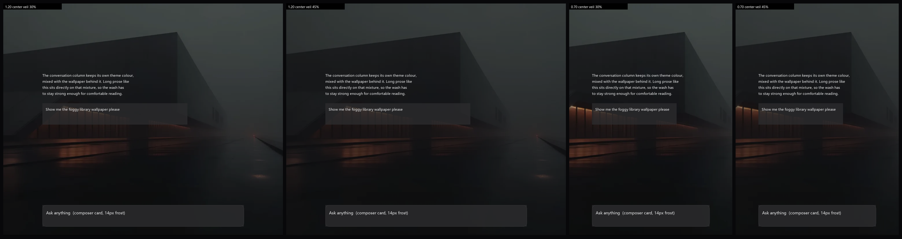

# dsh-plugin-chat-backdrop

> A DeepSeek Harness client plugin: paints a wallpaper behind the chat transcript, turns the
> surfaces on top of it into translucent glass, and adds a **Settings → General** row to pick a
> local picture and drag a transparency slider. Pure client-side (CSS injection + theme-token
> rebinding), no host code, no build step at install time.

给 [DeepSeek Harness](https://github.com/deepseek-ai/deepseek-harness) 的**对话区**加一张背景图，
并把盖在它上面的表面做成半透明玻璃；**设置 → 通用**里有一行可以选本地图片、拖滑杆调透明度。

- **纯客户端插件**：只往页面注入一张 `<style>` + 改写主题 token，宿主侧是空壳
- **不碰哈希类名**：只用 `data-*` / `data-slot` 锚点 + 主题 token，UI 改版不会静默失效
- **可选图、可调透明**：设置页选本地任意图片（自动降采样到长边 2400px 再存），滑杆 0–100%
- **跟随主题**：亮/暗模式用宿主自己的 token，菜单、模态框、Tooltip 保留官方材质
- **装好即用**：仓库里带了构建好的 `dist/client.js`，目标机器不需要 Node / pnpm 构建



> 预览由 `tools/preview-crop.py` 对内置示例图做 `cover` 裁剪 + 主题底色蒙版 + 假 UI 合成，
> 用来比较蒙版浓度与裁剪位置，**不代表运行中的真实画面**。

## 安装（换一台机器）

插件就是个 profile 组合包，三种装法任选：

**① 图形界面（最省事）**

侧栏 **插件** 页 → **添加插件** → 输入框填：

```
github:Ternity/dsh-plugin-chat-backdrop
```

→ 安装（装完默认启用）。也可以填完整 git 地址：

```
git+https://github.com/Ternity/dsh-plugin-chat-backdrop.git
git+ssh://git@github.com/Ternity/dsh-plugin-chat-backdrop.git   # 有 SSH key 时
```

**② 命令行**

```bash
dsh plugin --profile <profile-id> add github:Ternity/dsh-plugin-chat-backdrop
```

`profile-id` 在桌面版通常就是 `desktop`；不确定时看 `~/.dsh/profiles/` 下的目录名。

**③ 离线 / 网络不好时**

GitHub 页面 → **Code ▾ → Download ZIP** → 解压 → 插件页 **添加插件** 填解压目录的**绝对路径**
（本地路径是官方支持的安装来源，管理器会直接读它的 `package.json`）。

装好后：**设置 → 通用**，在「外观 / 字体大小 / 会话视图」下面应该出现本插件的两行。
如果样式没出现而插件页里显示已启用，重启一次 App（新 bundle 有时需要重启宿主进程）。

> 要求：DSH 0.2.x（客户端插件 `dsh.client` 契约）。实测于 0.2.0-rc.2 / 0.2.1。
> 宿主会对 `git` 规格做一次 `git ls-remote` 预检，所以仓库必须能从目标机器访问到。

### 网络受限时（github.com 连不上）

`github:` / `git+https://github.com/...` 规格走的是 **github.com 的 HTTPS**。有些网络里
`git clone https://github.com/...` 会直接失败（`schannel: failed to receive handshake`），
此时用下面任意一条路：

**① codeload tarball 地址**（管理器支持"压缩包"来源，且对压缩包**不做** GitHub 预检；
实测 `codeload.github.com` 在 github.com 被墙时仍可达）：

```
https://codeload.github.com/Ternity/dsh-plugin-chat-backdrop/tar.gz/refs/heads/main
```

想锁定到某个提交（可复现、不会跟着 main 变）：

```
https://codeload.github.com/Ternity/dsh-plugin-chat-backdrop/tar.gz/<commit-sha>
```

**② 下载 ZIP → 本地绝对路径**：GitHub 页面 **Code ▾ → Download ZIP**，解压后把目录绝对路径
填进「添加插件」（本地路径是官方支持的来源）。

**③ 有 GitHub SSH key 的机器**（`~/.ssh/config` 配好 `github.com` + 私钥）：

```
git+ssh://git@github.com/Ternity/dsh-plugin-chat-backdrop.git
```

三条路装出来的是同一个包 —— 仓库里带了构建好的 `dist/client.js`，目标机器不需要 Node / 构建步骤。

> **升级**：DSH 目前对插件安装后不做自动更新，流程是先卸载再装新版（同上任何一种来源）。
> 你本地选过的背景图与透明度存在 `localStorage`，重装不会丢。

## 日常使用：设置 → 通用

| 行 / 控件 | 作用 |
|---|---|
| **对话背景图** 行 | 描述行显示当前用的是内置图还是哪个本地文件；右侧是缩略预览 + **选择图片…** + **恢复默认图** |
| **选择图片…** | 打开系统文件对话框（`accept="image/*"`），选本地任意图片。渲染端用 `createImageBitmap` 解码 → canvas 缩到长边 ≤ 2400px → WebP q0.82（不支持则 JPEG）→ data URL |
| **缩略预览** | 64×36 小色块，用**和壁纸完全相同的三层**（主题蒙版 + 压暗 + 图片）由同名变量绘制，拖滑杆时同步变化 |
| **背景图透明度** 行 | 滑杆：0% = 只有主题底色（看不到图）；100% = 图片最清楚。写入 `opacity`，蒙版 = `1 - opacity`；右侧是百分比读数与 **全部恢复默认** |

选择与拖动**即时生效、无需重启**，持久化在渲染端 `localStorage`（键 `dsh.chatBackdrop`）。
自选图先缩到长边 2400px 再编码：`localStorage` 每个 origin 约 5 MB、data URL 还有约 1.37 倍膨胀，
所以超大原图会先被压到几百 KB；万一写不进去（配额 / 隐私模式），那一行会提示
「图片太大，只能在本次会话生效」，画面照常生效但不持久化。

## 停用 / 卸载

1. **临时关掉**：侧栏 **插件** 页把 `chat-backdrop` 这一行关掉（配置保留，可再开）；
2. **关掉整个包**：同一页把 `dsh-plugin-chat-backdrop` 这个组合包关掉；
3. **彻底移除**：插件页删除组合包（走 pnpm remove），或手工删掉 profile `package.json` 里
   `dependencies` / `dsh.profile.bundles` 两处条目后重启 App。

## 它是怎么工作的

DSH 的聊天区里每个关键表面都只从**一个主题 token** 取色，而这些 token 可以在子树上重新绑定。
所以插件不做选择器大战，只在离消费者最近的地方换掉那个变量的值：

| 表面 | 稳定钩子 | 消费的 token | 插件做的事 |
|---|---|---|---|
| 对话正文容器 | `[data-conversation-content]` | 自身无背景 | 画三层背景：主题底色蒙版 + 可选黑色压暗 + 图片 |
| 用户气泡 | （无 data 钩子） | `--dsw-specific-bubble` | 在正文容器上重绑为半透明版本 |
| 输入卡片 | `[data-composer-card]` | `--dsw-specific-input-major` | 在卡片上重绑 + `backdrop-filter` 磨砂 |
| 输入区渐隐带 | `[data-composer-seat]` | `--dsw-alias-bg-base` | 只在这个子树里换成半透明蒙版，渐变形状保留 |

两条必须遵守的规则（`src/client.template.js` 的注释里也有）：

1. **不要在同一个元素上用同名变量定义自己**（`--x: color-mix(… var(--x) …)`）——那是循环依赖，
   整条声明会在计算期失效。派生色一律先在 `<body>` 上用新的 `--dshx-cb-*` 名字算好，再往下赋给官方名字。
2. **不要碰 `body` 上的 `--dsw-alias-*`**——主题 presenter 用 inline style 写在 `body` 上，
   样式表赢不了，而且那些 token 被模态框、菜单、Tooltip 共用。

暗色判定用 `body[data-ds-dark-theme]`（宿主 ThemePresenter 打的属性），**不用** `prefers-color-scheme`
——后者只跟随操作系统，跟应用内主题选择可以不一致。

设置行本身也按宿主样式画：结构与尺寸抄自宿主自己的通用设置行（`ui-conversation` 的
`EnterBehaviorRow.module.css`：`padding: 16px 0`、`border-bottom: .5px solid var(--dsw-alias-border-l2)`、
14px/400 标题、12px 三级色描述、36px 圆角胶囊控件），类名全部换成 `dshx-cb-*` 前缀，
颜色只用 `--dsw-alias-*` token；文案走宿主 locale（注册时带 `locale` 命名空间）。

## 自定义

**换内置图**（所有人 / 所有会话默认看到的那张）：

```bash
python tools/make-asset.py "/path/to/your-picture.png"   # 需要 Pillow
node tools/build-client.mjs
```

**改默认浓度等参数**：`src/client.template.js` 顶部的 `DEFAULTS`，改完 `node tools/build-client.mjs`：

| 键 | 含义 |
|---|---|
| `opacity`（默认 `0.62`） | 就是滑杆那个值：0 = 只有主题底色，1 = 图片最清楚 |
| `imageDim`（默认 `0`） | 在主题蒙版外再压一层黑（亮图/细节多的图用得上） |
| `cardKeep` / `bubbleKeep` / `cardBlur` | 输入卡片与用户气泡的保留度、卡片磨砂半径 |
| `imageSize` / `imagePosition` | 对应 `background-size` / `background-position` |
| `embedded` | 是否也给右栏 subagent 的内嵌会话铺图 |

**运行时调**（渲染端控制台，同样写进 `localStorage`）：

```js
__DSH_CHAT_BACKDROP__.config                        // 当前值
__DSH_CHAT_BACKDROP__.setConfig({ opacity: 0.85 })  // 立刻生效
__DSH_CHAT_BACKDROP__.setConfig({ cardBlur: 0 })    // 关掉卡片磨砂
__DSH_CHAT_BACKDROP__.reset()                       // 回到默认
```

## 目录

| 路径 | 作用 |
|---|---|
| `src/client.template.js` | 浏览器半侧源码（`__BACKDROP_DATA_URL__` 是图片占位符） |
| `tools/build-client.mjs` | 把模板 + `assets/backdrop.webp` 合成 `dist/client.js`（零依赖 Node 脚本） |
| `tools/make-asset.py` | 把任意源图缩放/编码成 `assets/backdrop.webp` |
| `tools/preview-crop.py` | 离线生成上面那张设计预览 |
| `dist/client.js` | 真正被宿主伺服给浏览器的产物（**提交进仓库**，不要手改） |
| `lib/index.js` | 宿主半侧：空的 `apply()`，只为让 Loader 认识这个包 |
| `cordis.patch.yml` | 本组合包的补丁层：插入一行 `chat-backdrop` |
| `.github/workflows/verify.yml` | CI：确认 `dist/client.js` 与源码同步、能解析、manifest 指向真实文件 |

## 验证（没有浏览器控制时）

官方插件规范要求：没有浏览器控制时，验证限于 **JS 语法 + manifest + 活的 Client slot**。
本插件把这三样都做到，并把「样式到底有没有生效」编进一个可 inspect 的占位 id：

1. **语法**：`node --check dist/client.js`
2. **manifest**：插件页 / `plugin_manager list_bundles` 里出现 `dsh-plugin-chat-backdrop`，
   `enabled: true`，行 `chat-backdrop` 存在
3. **活的 Client slot**（需要页面连着）：

```
cordis_inspect_query platform=client provider=Slots method=listSubTree
    input={"root":"settings.general.item"}        # 看设置行在不在、order 对不对
cordis_inspect_query platform=client provider=Slots method=listSubTree
    input={"root":"conversation.composer.dock"}   # 读自检位串
```

自检 id 形如 `chat-backdrop-diag-s1a1i1v1h1c84o62u0w1b1s1-dark-has`：

| 位 | 含义 |
|---|---|
| `s1` | `<style data-plugin="…">` 在文档里 |
| `a1` | `<html data-dsh-chat-backdrop="1">` 已设置 |
| `i1` / `v1` | `--dshx-cb-image` 在 `<html>`、`--dshx-cb-surface` 在 `<body>` 上解析出值 |
| `h1` | `[data-conversation-content]` 的 computed `background-image` 里含图片 |
| `c84` | 输入卡片 computed alpha = 0.84（= `cardKeep`，说明 token 重绑生效） |
| `o62` | 当前配置的 `opacity` × 100 |
| `u0`/`u1` | 0 = 内置图；1 = 正在用设置页自选的图 |
| `w1` / `b1` / `s1`(末位) | canvas 能编 WebP / `createImageBitmap` 可用 / `localStorage` 可写 |
| `dark`/`light` | 当前主题 |

任何一位掉下来，就知道是哪一步断了（钩子改名 / 变量没解析 / 选择器没匹配 / 重绑失效）。

> 坑：`settings.general.item` 是 `settings.section` 里 general 条目的 child，**只在设置面板那一条
> entry 挂载期间才被声明**。面板没打开时 `listSubTree` 里既没有官方行也没有本插件的行——
> 别据此判断"没生效"，先打开一次设置面板再查。

## 与官方插件规范的一致性

对照 `cordis-plugin-development` skill 的 `references/practices.md`：

| 规范 | 本插件 |
|---|---|
| 用 React 组件渲染在 slot 里，不塞 iframe | ✅ 设置行是 slot occupant |
| 只用 `--dsw-alias-*` token 上色 | ✅ 全部颜色走 token |
| **不要 `require` 任何 DSH Client 包**（会随版本变，抛错会整块顶掉 slot 入口）；自己写控件、抄宿主 markup/CSS、类名换前缀 | ✅ 只 `require('react')`；行结构与尺寸逐条抄宿主通用设置行 |
| 注册走 `ctx.slots.inject(ownerKey, () => ctx.slots.register(...))`，随 owner 折叠自动装卸 | ✅ |
| 文案走宿主 locale | ✅ 注册带 `locale` 命名空间 + `ctx.locale.register`，并保留本地字典兜底 |
| 不要往 `document.body` 追加节点 | ⚠️ 唯一一处有意偏离：往 `document.head` 追加 `<style data-plugin=…>`（这是宿主 `ui-theme` 与第三方插件共同使用的唯一受支持 CSS 注入路径），不新增任何元素 |
| 偏好放 `Config`（写进 `cordis.patch.yml`） | ⚠️ 有意选择：纯客户端插件 + 滑杆要即时预览，偏好放渲染端 `localStorage`（宿主官方 `dsh-client-store` 的持久化同样是 localStorage）；代价是清缓存即丢 |

## 已知限制

- **对话头部那条不铺图**：标题栏在对话根容器里、在正文容器之外，而根容器是实心主题色，
  所以图片从正文顶部开始。想连头部一起铺需要运行时向上找根容器并打标记，属于可选增强。
- **Trajectory / Review 视图会整块盖住壁纸**（它们自己用不透明的 `--dsw-alias-bg-layer-1`），
  这是宿主设计，不去硬改；菜单、模态框、Tooltip 同理不受影响。
- 自选图存在渲染端 `localStorage`，**不进** profile 配置：换机器 / 清缓存就没了；
  想变成"出厂默认图"要走 `tools/make-asset.py` + 重新构建。
- 自选图会降采样到长边 2400px 再存，不是原图无损；要原图效果请改内置图。
- 只在**装了它的 profile** 里生效。

## 许可与素材

代码：[MIT](LICENSE)。

内置示例图（`assets/backdrop.webp`，雾中图书馆）是作者的本地素材，仅作**示例**；
它已压缩内联进 `dist/client.js`。如果你 fork 这个仓库，请自行确认这张图的使用权，
或按上面「换内置图」的步骤替换成你自己的图片 / 纯色。设置页选图功能不依赖内置图。
